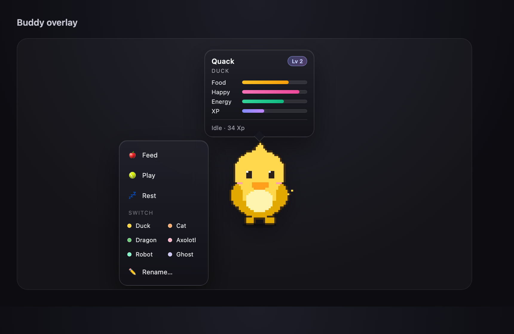

# opencode-buddy

A virtual pet for opencode. It lives in the TUI sidebar as ASCII art and floats over OpenCode Desktop as a draggable SVG pet. One buddy per session; it earns XP from your actual work.

| TUI | Desktop |
| --- | --- |
|  |  |

## Install

Requires OpenCode 2.2.6+.

```bash
npm install -g @mark_future_ai/opencode-buddy
```

The postinstall registers the plugin in `~/.config/opencode/opencode.json`. If that file contains comments, add the entry yourself:

```jsonc
{
  "plugins": ["@mark_future_ai/opencode-buddy"]
}
```

Reload opencode.

## Usage

### Desktop

- Drag to move; the position is remembered.
- Click for stats; right-click to feed, play, rest, rename, or switch pets.
- Hide from the right-click menu. Bring it back with `Cmd+K` / `Ctrl+K` → **Toggle floating pet**.
- **Built-in** lists the six presets; **Pets** lists custom packs.

### TUI

| Command | Effect |
| --- | --- |
| `/buddy` | Show the current buddy's stats |
| `/buddy-feed` | Feed (+25 hunger, -5 energy) |
| `/buddy-play` | Play (+15 happy, +1 xp) |
| `/buddy-rest` | Rest (+30 energy) |
| `/buddy-list` | List session buddies |
| `/buddy-rename` | Rename the buddy |
| `/buddy-switch` | Switch species |

## Built-in pets

Quack (duck), Miso (cat), Ember (dragon), Lumi (axolotl), Bolt (robot), Boo (ghost).

## Custom pets (Desktop)

The Desktop pet loads community packs in the Codex pet format. Drop a pack in either place:

- `~/.codex/pets/<id>/` — auto-detected, read-only
- `~/.config/opencode-buddy/pets/<id>/` — OpenCode-local

A pack is `pet.json` plus a spritesheet: 8×9 atlas, 192×208 px cells, WebP/PNG/GIF, up to 5 MB.

```json
{
  "id": "my-pet",
  "displayName": "My Pet",
  "spriteVersionNumber": 2,
  "spritesheetPath": "spritesheet.webp"
}
```

Custom packs are Desktop-only; the TUI keeps the built-in ASCII pets.

## Uninstall

```bash
npm uninstall -g @mark_future_ai/opencode-buddy
```

Remove `"@mark_future_ai/opencode-buddy"` from `opencode.json`. Delete `~/.config/opencode-buddy/` to remove buddies and pet preferences; `~/.codex/pets/` is never modified.

## License

MIT
